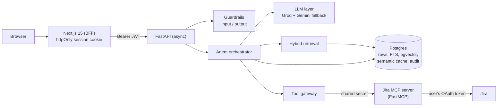

# Dobby

A secure AI assistant for teams. It answers questions from the company's own documents with
per-document access control, and can act in Jira on a person's behalf, with human approval
for anything that changes data. Every answer is grounded in sources the asker is allowed to
read, every step is visible, and every action is audited.

> Built as a production-grade reference: nothing is mocked. Real Postgres + pgvector, real
> models, real MCP server, real SSO. Deployment and operations notes live in
> [docs/deployment.md](docs/deployment.md).

## What it does

- **Grounded chat.** Answers cite their sources as `[1]`, `[2]`. If the allowed documents do not
  cover the question, it says so instead of guessing.
- **Document-level access control.** Upload PDF, DOCX, TXT or Markdown. Each document is visible to
  everyone in the workspace, or only to chosen roles and people. The model never sees a document
  the asker cannot read.
- **Actions with a human in the loop.** Jira tools run through an MCP server with the user's own
  Jira OAuth token. Anything that writes shows an approval card first.
- **Self-serve workspaces.** Anyone signs in with Google. A company domain shares one workspace, a
  personal account gets a private one, and the first person in a workspace administers it. Admins
  invite teammates by email.
- **Visible agent.** A live Agent activity panel shows each step with its real timing: guardrails,
  intent, cache, model routing, retrieval, tool calls, approvals, validation.

## Architecture



One Postgres holds everything that matters: users, workspaces, documents, chunks with their
embeddings (pgvector), the keyword index (tsvector), the semantic cache, pending approvals,
encrypted integration tokens, and the append-only audit log. There is no second datastore to
keep in sync, so an access-control change or a delete cannot leave a stale copy behind.

### The request pipeline

```
Auth + RBAC + quotas
  → Input guardrails        injection score, PII masking, policy rules
  → Intent classification   small model, structured JSON (runs in parallel with the cache embedding)
  → Semantic cache          permission re-validated on every hit
  → Model router            small vs frontier model by intent, risk and complexity
  → Agent loop              retrieval (RAG) and tool calls, until ready to answer
  → Grounding validation    citations must refer to retrieved, readable sources
  → Output guardrails       DLP, PII, markup stripping, policy
  → Stream to the user      replayed as chunks only after validation
```

The full diagram and the mapping from each box to its module are in
[docs/architecture.md](docs/architecture.md).

### Retrieval (RAG)

- **Ingestion:** parse, chunk with overlap, embed (Gemini embeddings, 768 dims), then store rows and
  vectors in one transaction. Documents are scanned for injection at ingest and again at read time.
- **Hybrid search in a single SQL round trip:** a vector branch (pgvector HNSW, cosine) and a
  keyword branch (Postgres full-text search, `websearch_to_tsquery`) are fused with Reciprocal Rank
  Fusion, then optionally reranked by a model when there are more candidates than needed.
- **Access control inside the query:** tenant and document ACL are part of the WHERE clause for both
  branches, and the same rule is applied again in Python on every row. The Python rule is
  authoritative, so a bug in either layer cannot leak a document.
- **Untrusted by default:** retrieved excerpts are scanned, dropped above an injection threshold,
  and fenced in delimiters the system prompt tells the model never to obey.

### Semantic cache

Repeated questions are answered without calling a model. The cache is keyed by workspace, and every
hit **re-checks the caller's access to every document the cached answer was built from**. Role-only
keys are not enough because per-user grants differ between people with the same roles. Answers that
used a tool, small talk, and anything modified by a guardrail are never cached. Changing or deleting
a document purges the answers that cited it.

### Agent loop, tools and approvals

- The model uses native function calling. One virtual tool searches company knowledge; the others
  come from the MCP server.
- **Fail-closed policy** (`backend/config/policy.yaml`): a tool that is not listed is denied. Writes
  require approval; reads do not.
- **Approval** is a `pending_actions` row. Deciding it is a single atomic compare-and-set with a
  15-minute expiry, so it cannot be replayed or decided twice.
- **On-behalf-of:** tool calls carry the user's own Jira OAuth 3LO token (stored encrypted with
  Fernet), so Jira's own permissions apply. The MCP server holds no Jira credentials and requires a
  shared secret.
- Pure knowledge questions get their excerpts up front and are answered without a tool round trip.
  An empty search ends the turn immediately instead of looping.

### LLM layer

- Provider-neutral `LLMClient` protocol with a Gemini client and an OpenAI-compatible client (Groq).
- `FallbackLLM` tries the preferred provider and retries once on the other when it fails or is
  rate-limited. Embeddings always use Gemini, because vectors from different models are not
  comparable. Gemini 3 `thought_signature` values are round-tripped so tool calls keep working.
- Per-day quota errors fail fast to the fallback instead of retrying for seconds.

## Guardrails and security

| Threat | Control |
|---|---|
| Unauthorized access | Google ID token verified server-side (audience, verified email, hosted-domain claim); roles re-read from the database on every request; deactivation takes effect on the next request |
| Session theft by script | The session token lives in an httpOnly cookie set by the Next.js server; browser JavaScript never sees it |
| Reading documents you should not | Tenant + ACL in the SQL query and a final Python check; workspaces are hard walls even for admins |
| Cache leaking across users | Permission re-validation on every hit; tool-using answers are never cached |
| Prompt injection (user input) | Heuristic score, plus an LLM classifier for borderline input; fail closed |
| Indirect injection (documents, tool output) | Scan, drop above a threshold, fence as untrusted data |
| Data exfiltration through output | DLP masks secrets, keys, cards and SSNs; markdown and HTML images are removed; internal markers are blocked |
| Unauthorized or unintended actions | Fail-closed tool policy, per-user OAuth token, human approval for writes, single-use expiring approvals |
| Replaying an approval | Atomic compare-and-set; a decided action cannot be decided again |
| Tampering with the audit trail | A database trigger rejects UPDATE and DELETE on `audit_log`; sensitive keys are redacted before writing |
| Stolen database | Third-party tokens are Fernet-encrypted with a key held outside the database |
| Abusing the MCP server | Shared-secret protected, holds no credentials, stateless |
| Cost abuse | Per-user burst and daily quotas, input length limit, agent step limit |

Answers are generated in full, validated, and only then replayed to the browser in chunks. That is
deliberate: forwarding raw model tokens would bypass the output guardrails.

## Multi-tenancy and roles

Every user, document, invitation and cache entry belongs to exactly one workspace. A verified
company domain (Google Workspace `hd` claim) shares a workspace; a personal address gets its own.
The admin page, the audit log, document lists and search never cross workspaces.
Roles are `employee`, `manager`, `hr` and `admin`; managers and HR can upload and share documents,
admins manage people and read the audit log. Invitations let someone outside the domain join a
workspace with chosen roles.

## Observability

- **Agent activity trace:** every request produces a structured trace (status, duration, a
  human-readable summary per step). It streams as `trace` events, is stored with the answer, and can
  be replayed for any past message. It never contains document text or secrets.
- **Structured logs** (structlog) with request ids, **Prometheus metrics** (requests by intent and
  outcome, model calls, cache lookups, retrievals) and **spans** around retrieval, generation and
  validation.
- **Audit trail:** append-only, immutable at the database level, with key-name-based redaction.

## Quality: tests, evals and the release gate

- **68 tests** (35 unit, 33 integration). The integration tests run the real application against
  real Postgres with pgvector and the real MCP server over HTTP, with a fake model, and assert
  security properties: ACL and workspace isolation, cache non-leakage, injection blocking in input,
  documents and tool output, approval single-use and expiry, role enforcement, audit immutability,
  invitations and signup rules.
- **Evaluation suite** (`backend/evals/`): data-driven cases with thresholds. Security cases must
  pass 100%, answer-quality cases 80%. It runs deterministically in CI and against real models
  on demand, and it refuses to run on any database not named like a test or eval database.
- **Live end-to-end check** (`evals/e2e_live.py`): drives a running API with real models, checks
  answer correctness, refusals, injection blocking and cache hits, and reports latency per stage.
- **CI** (GitHub Actions): lint, strict mypy, tests and the evaluation gate for the backend; lint,
  typecheck, tests and build for the frontend; Docker image builds.

## Performance engineering

- Hybrid retrieval is **one SQL round trip** instead of four.
- The query embedding and the intent classification run **concurrently**; vector and keyword search
  are one statement; the query embedding is reused for retrieval.
- Rerank and tool round trips are skipped when they cannot change the outcome.
- Database connections are pre-warmed at startup, and pooled connections are checked before use.
- Gemini runs with low thinking effort; Groq answers first with Gemini as the fallback.
- Frontend: route-level code splitting and `next/dynamic` for heavy components, skeletons for every
  route, a small stale-while-revalidate cache, frame-batched token rendering, memoized messages.

## Tech stack

| Area | Technology |
|---|---|
| API | Python 3.12, FastAPI (async), Pydantic Settings, SSE streaming |
| Data | PostgreSQL, SQLAlchemy 2 (async) with asyncpg, Alembic, pgvector (HNSW), tsvector full-text search |
| Models | Gemini (google-genai), Groq via an OpenAI-compatible client, structured JSON output, function calling |
| Tools | Model Context Protocol (FastMCP, streamable HTTP), Jira OAuth 2.0 (3LO) |
| Auth and security | Google Identity Services, JWT sessions, Fernet token encryption, RBAC, httpOnly cookies |
| Frontend | Next.js 15 (App Router, BFF route handlers), React 19, Tailwind 4, react-markdown, vitest |
| Observability | structlog, Prometheus client, trace events |
| Quality | pytest, ruff, mypy (strict), the eval harness, GitHub Actions |
| Packaging | Docker, Docker Compose, a Render Blueprint |

## Repository layout

```
backend/
  app/
    api/           routes: auth, chat (SSE), documents, integrations, admin
    agent/         orchestrator, intent and router, policy, guardrails, tool gateway, MCP client
    rag/           parsing, chunking, ingestion, hybrid retrieval, pgvector access, reindex
    cache/         permission-aware semantic cache
    llm/           provider-neutral client, Gemini, OpenAI-compatible, fallback
    security/      auth, RBAC, injection detection, PII, encryption
    observability/ trace events, audit, metrics, spans
    db/            models and session handling
  jira_mcp/        the Jira MCP server
  alembic/         migrations (schema, audit immutability, pgvector, workspaces)
  config/          tool policy (fail closed)
  evals/           evaluation cases, thresholds, runners
  tests/           unit and integration tests
frontend/          Next.js app: chat, documents, settings, admin, activity panel
docs/              architecture and deployment notes
```

## Run it locally

```bash
docker compose up -d postgres                      # Postgres with pgvector on :5433
cd backend && python3.12 -m venv .venv && source .venv/bin/activate
pip install -e ".[dev]" && cp .env.example .env    # add GEMINI_API_KEY and GOOGLE_CLIENT_ID
alembic upgrade head
uvicorn --factory app.main:create_app --port 8000
cd ../frontend && npm install && npm run dev       # http://localhost:3000
```

Configuration is documented in [docs/deployment.md](docs/deployment.md).

## Known limitations

- Answers appear in chunks after validation, not token by token as the model produces them.
- Retrieval has no relevance cutoff: it returns the nearest allowed chunks and the model is told to
  say when they do not answer. A score threshold needs calibration against real data.
- PII detection is pattern based (Luhn-checked cards, SSNs, keys, tokens), not free-form names.
- Only Jira is integrated, through one MCP server URL.
- Resuming after an approval loses the citations from before the approval.
