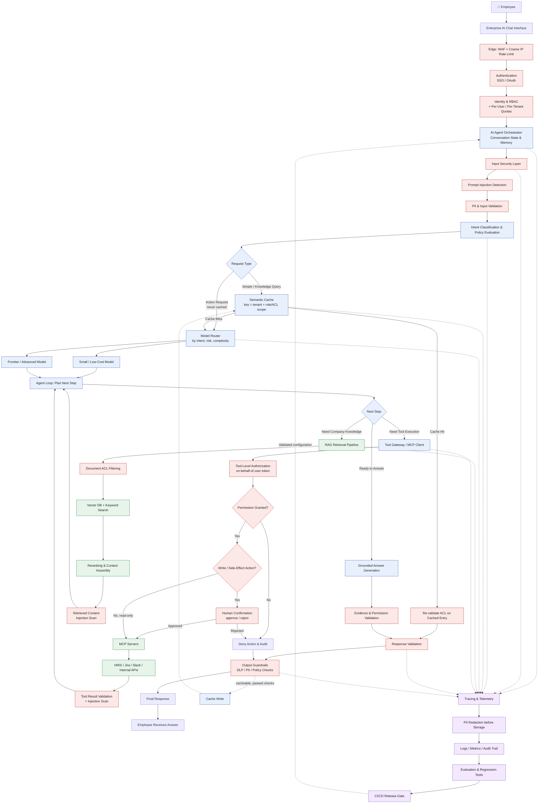

# Architecture

The request flow below is the design the code implements. Every box maps to a module.

(The same diagram is in [`architecture.mmd`](architecture.mmd).)

## Where each stage lives

| Stage in the diagram | Code |
|---|---|
| Edge: WAF, coarse IP rate limit | Cloudflare (outside the app); see README "Cloudflare" |
| Authentication (Google SSO) | `backend/app/security/auth.py`, `app/api/auth.py` |
| Identity, RBAC, per-user quotas | `app/deps.py` (`current_principal`, `enforce_quota`), `app/security/rbac.py` |
| Orchestrator, conversation state | `app/agent/orchestrator.py`, tables `conversations` / `messages` |
| Input security (injection, PII) | `app/agent/guardrails.py::check_input`, `app/security/injection.py`, `app/security/pii.py` |
| Intent classification and policy | `app/agent/intent.py`, `app/agent/policy.py`, `config/policy.yaml` |
| Semantic cache and ACL re-validation | `app/cache/semantic.py`, `app/rag/vectorstore.py::CacheIndex` |
| Model router (small vs frontier) | `app/agent/intent.py::choose_model` |
| RAG: ACL filter, hybrid search, rerank | `app/rag/retrieval.py`, `app/rag/vectorstore.py` |
| Retrieved-content injection scan | `app/agent/guardrails.py::sanitize_untrusted` |
| Tool gateway, per-user authorization | `app/agent/gateway.py`, `app/agent/jira_auth.py` |
| Human approval for writes | `app/agent/orchestrator.py::_dispatch` / `resume`, table `pending_actions` |
| MCP server (Jira) | `backend/jira_mcp/server.py` |
| Evidence validation | `app/agent/orchestrator.py::_validate_grounding` |
| Output guardrails (DLP) | `app/agent/guardrails.py::check_output` |
| Tracing and telemetry | `app/observability/` (structured logs, Prometheus metrics, spans) |
| Audit trail | `app/observability/audit.py`, append-only table `audit_log` |
| Evaluation and release gate | `backend/evals/`, `.github/workflows/ci.yml` |

## Design decisions worth knowing

**Permission-aware cache.** A cache hit is only returned after the caller's access to every
document the cached answer was built from has been re-checked in Postgres. Role-based cache
keys are not enough because per-user grants differ between people with the same roles.
Answers that used any tool (so could contain user-specific data) are never cached.

**Access control is enforced twice, and workspaces are hard walls.** The tenant and document ACL
are part of the single hybrid SQL query (vector and keyword branches), then checked again in
Python on every row. The Python rule is authoritative. Vectors live in Postgres next to the rows
they describe, so an ACL change or a delete cannot leave a stale copy behind.

**Untrusted content is data.** Retrieved excerpts and tool results are scanned for
injection, dropped if they score above the threshold, and fenced with delimiters the system
prompt tells the model never to obey.

**Writes need a human.** Any tool the policy marks as a write returns an
`approval_required` event and stops. Approval is a single atomic compare-and-set on
`pending_actions`, so it cannot be replayed, and pending actions expire.

**On-behalf-of tool calls.** Jira calls carry the employee's own OAuth token. The MCP server
holds no Jira credential, so Jira itself decides what that person may do.

**Output is validated before it is shown.** The model's answer is generated in full, checked
(citations, DLP, policy), and only then replayed to the client as token events. Forwarding raw
model tokens would bypass output guardrails.

**Fail closed.** Unknown tools are denied, an unreachable injection classifier blocks
borderline input, and the intent classifier falls back to the most guarded path.
